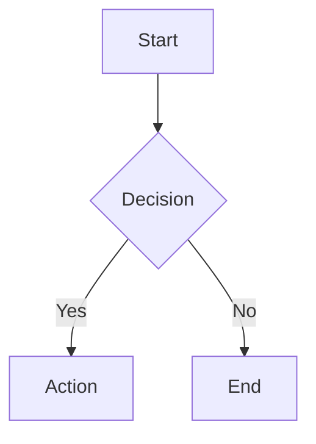

# MdToPDF

A command-line tool that converts Markdown files to **PDF** or **DOCX** with full support for GitHub Flavored Markdown styling, syntax highlighting, Mermaid diagrams, emoji, and embedded images.

## Features

- **PDF & DOCX output** -- choose your format with a single flag
- **Mermaid diagrams** -- renders `mermaid` code blocks as SVG (Mermaid v11, bundled offline)
- **Syntax highlighting** -- code blocks highlighted via highlight.js
- **Image embedding** -- local and remote images are inlined as base64 data URIs
- **Emoji support** -- renders shortcodes like `:rocket:` into native emoji
- **Batch conversion** -- point at a folder to convert all `.md` files at once
- **Recursive mode** -- process subdirectories with `-r`
- **Offline rendering** -- all assets are bundled locally, no internet required

## Prerequisites

- [Node.js](https://nodejs.org/) v18 or later

## Setup

```bash
git clone https://github.com/elmcherqui/MdToPDFApp.git
cd MdToPDFApp
npm install
npm run build
```

### Install as a global command

```bash
npm link
```

Now `mdtopdf` is available from anywhere in your terminal.

To uninstall:

```bash
npm unlink -g mdtopdfapp
```

## Usage

```bash
# Convert a single file to PDF (default)
mdtopdf ./notes.md

# Convert to DOCX
mdtopdf ./notes.md -f docx

# Convert all markdown files in a folder
mdtopdf ./docs

# Recursive conversion with custom output directory
mdtopdf ./docs -r -o ./output
```

### Options

| Option | Description | Default |
|---|---|---|
| `-f, --format <format>` | Output format: `pdf` or `docx` | `pdf` |
| `-o, --output <dir>` | Output directory | Same as input |
| `-r, --recursive` | Process subfolders recursively | `false` |
| `-V, --version` | Show version number | |
| `-h, --help` | Show help | |

## Mermaid Diagrams

Use fenced code blocks with the `mermaid` language tag:

````markdown

````

Diagrams are rendered to SVG using Mermaid v11, bundled locally for fully offline use.

## Project Structure

```
MdToPDFApp/
├── src/
│   ├── index.ts        # CLI entry point (commander)
│   ├── discovery.ts    # File discovery and path resolution
│   ├── parser.ts       # Markdown-to-HTML via markdown-it
│   ├── images.ts       # Image embedding (local + remote)
│   ├── template.ts     # HTML wrapper with styles and mermaid
│   ├── renderer.ts     # PDF (Puppeteer) and DOCX rendering
│   └── types.ts        # Shared TypeScript interfaces
├── assets/
│   └── style.css       # GitHub-flavored markdown styles
├── tests/              # Unit and e2e tests (vitest)
├── package.json
└── tsconfig.json
```

## Development

```bash
# Build
npm run build

# Run tests
npm test
```

## Tech Stack

- **TypeScript** -- type-safe source code
- **markdown-it** -- Markdown parsing with plugins
- **highlight.js** -- syntax highlighting for code blocks
- **Mermaid v11** -- diagram rendering (bundled offline)
- **Puppeteer** -- headless Chrome for PDF generation
- **html-to-docx** -- DOCX conversion
- **commander** -- CLI argument parsing
- **vitest** -- test runner

## License

ISC
