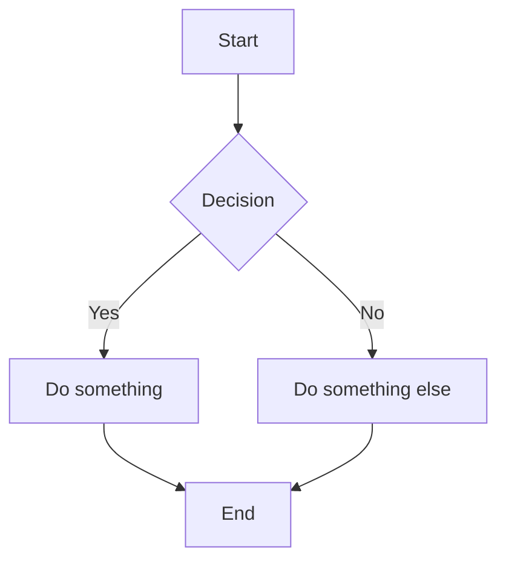

# MdToPDF Implementation Plan

> **For Claude:** REQUIRED SUB-SKILL: Use superpowers:executing-plans to implement this plan task-by-task.

**Goal:** Build a Node.js CLI tool that converts Markdown files (with images, emoji, code blocks, and Mermaid diagrams) to PDF or DOCX.

**Architecture:** Pipeline-based — markdown is parsed to HTML, styled with CSS, then rendered to PDF via Puppeteer or converted to DOCX via html-to-docx. Mermaid diagrams are rendered client-side inside Puppeteer using mermaid.js.

**Tech Stack:** TypeScript, markdown-it, Puppeteer, highlight.js, html-to-docx, commander

---

### Task 1: Project Scaffolding

**Files:**
- Create: `package.json`
- Create: `tsconfig.json`
- Create: `src/types.ts`

**Step 1: Initialize the project**

Run:
```bash
cd /c/Users/User/Desktop/MdToPDFApp
npm init -y
```

**Step 2: Install dependencies**

Run:
```bash
npm install commander markdown-it markdown-it-emoji highlight.js puppeteer html-to-docx
npm install -D typescript @types/node @types/markdown-it
```

**Step 3: Create tsconfig.json**

```json
{
  "compilerOptions": {
    "target": "ES2020",
    "module": "commonjs",
    "lib": ["ES2020"],
    "outDir": "./dist",
    "rootDir": "./src",
    "strict": true,
    "esModuleInterop": true,
    "skipLibCheck": true,
    "forceConsistentCasingInFileNames": true,
    "resolveJsonModule": true,
    "declaration": true
  },
  "include": ["src/**/*"],
  "exclude": ["node_modules", "dist"]
}
```

**Step 4: Create src/types.ts**

```typescript
export interface ConvertOptions {
  format: "pdf" | "docx";
  outputDir?: string;
}

export interface FileEntry {
  inputPath: string;   // absolute path to .md file
  outputPath: string;  // absolute path to output file
}
```

**Step 5: Update package.json**

Add these fields:
```json
{
  "bin": {
    "mdtopdf": "./dist/index.js"
  },
  "scripts": {
    "build": "tsc",
    "start": "node dist/index.js"
  }
}
```

**Step 6: Verify it compiles**

Run: `npx tsc --noEmit`
Expected: No errors

**Step 7: Commit**

```bash
git init
git add package.json package-lock.json tsconfig.json src/types.ts docs/
git commit -m "feat: scaffold project with dependencies and types"
```

---

### Task 2: File Discovery Module

**Files:**
- Create: `src/discovery.ts`
- Create: `tests/discovery.test.ts`

**Step 1: Install test dependencies**

Run:
```bash
npm install -D vitest
```

Add to package.json scripts: `"test": "vitest run"`

**Step 2: Write the failing test**

Create `tests/discovery.test.ts`:

```typescript
import { describe, it, expect, beforeAll, afterAll } from "vitest";
import { discoverFiles } from "../src/discovery";
import * as fs from "fs";
import * as path from "path";

const tmpDir = path.join(__dirname, "tmp-discovery");

beforeAll(() => {
  fs.mkdirSync(tmpDir, { recursive: true });
  fs.mkdirSync(path.join(tmpDir, "sub"), { recursive: true });
  fs.writeFileSync(path.join(tmpDir, "a.md"), "# A");
  fs.writeFileSync(path.join(tmpDir, "b.md"), "# B");
  fs.writeFileSync(path.join(tmpDir, "c.txt"), "not md");
  fs.writeFileSync(path.join(tmpDir, "sub", "d.md"), "# D");
});

afterAll(() => {
  fs.rmSync(tmpDir, { recursive: true, force: true });
});

describe("discoverFiles", () => {
  it("returns single file when given a .md file path", () => {
    const files = discoverFiles(path.join(tmpDir, "a.md"), {
      format: "pdf",
    });
    expect(files).toHaveLength(1);
    expect(files[0].inputPath).toContain("a.md");
    expect(files[0].outputPath).toContain("a.pdf");
  });

  it("returns all .md files in directory (non-recursive)", () => {
    const files = discoverFiles(tmpDir, { format: "pdf" });
    expect(files).toHaveLength(2); // a.md, b.md — not sub/d.md
  });

  it("returns all .md files recursively", () => {
    const files = discoverFiles(tmpDir, { format: "pdf", recursive: true });
    expect(files).toHaveLength(3); // a.md, b.md, sub/d.md
  });

  it("uses custom output directory", () => {
    const files = discoverFiles(path.join(tmpDir, "a.md"), {
      format: "docx",
      outputDir: "/tmp/out",
    });
    expect(files[0].outputPath).toBe(path.join("/tmp/out", "a.docx"));
  });

  it("throws if input path does not exist", () => {
    expect(() =>
      discoverFiles("/nonexistent/path.md", { format: "pdf" })
    ).toThrow();
  });
});
```

**Step 3: Run test to verify it fails**

Run: `npx vitest run tests/discovery.test.ts`
Expected: FAIL — module not found

**Step 4: Implement discovery.ts**

Create `src/discovery.ts`:

```typescript
import * as fs from "fs";
import * as path from "path";
import { ConvertOptions, FileEntry } from "./types";

interface DiscoverOptions extends ConvertOptions {
  recursive?: boolean;
}

export function discoverFiles(
  inputPath: string,
  options: DiscoverOptions
): FileEntry[] {
  const resolved = path.resolve(inputPath);

  if (!fs.existsSync(resolved)) {
    throw new Error(`Input path does not exist: ${resolved}`);
  }

  const stat = fs.statSync(resolved);

  if (stat.isFile()) {
    if (!resolved.endsWith(".md")) {
      throw new Error(`Input file is not a markdown file: ${resolved}`);
    }
    return [buildFileEntry(resolved, options)];
  }

  if (stat.isDirectory()) {
    return findMarkdownFiles(resolved, options, options.recursive ?? false);
  }

  throw new Error(`Input path is neither a file nor a directory: ${resolved}`);
}

function findMarkdownFiles(
  dir: string,
  options: DiscoverOptions,
  recursive: boolean
): FileEntry[] {
  const entries: FileEntry[] = [];
  const items = fs.readdirSync(dir, { withFileTypes: true });

  for (const item of items) {
    const fullPath = path.join(dir, item.name);
    if (item.isFile() && item.name.endsWith(".md")) {
      entries.push(buildFileEntry(fullPath, options));
    } else if (item.isDirectory() && recursive) {
      entries.push(...findMarkdownFiles(fullPath, options, true));
    }
  }

  return entries;
}

function buildFileEntry(
  inputPath: string,
  options: DiscoverOptions
): FileEntry {
  const ext = options.format === "docx" ? ".docx" : ".pdf";
  const baseName = path.basename(inputPath, ".md") + ext;
  const outputDir = options.outputDir
    ? path.resolve(options.outputDir)
    : path.dirname(inputPath);
  return {
    inputPath,
    outputPath: path.join(outputDir, baseName),
  };
}
```

**Step 5: Update types.ts**

Add `recursive` to ConvertOptions:

```typescript
export interface ConvertOptions {
  format: "pdf" | "docx";
  outputDir?: string;
  recursive?: boolean;
}
```

**Step 6: Run tests to verify they pass**

Run: `npx vitest run tests/discovery.test.ts`
Expected: All 5 tests PASS

**Step 7: Commit**

```bash
git add src/discovery.ts src/types.ts tests/discovery.test.ts package.json
git commit -m "feat: add file discovery module with tests"
```

---

### Task 3: Image Processing Module

**Files:**
- Create: `src/images.ts`
- Create: `tests/images.test.ts`

**Step 1: Write the failing test**

Create `tests/images.test.ts`:

```typescript
import { describe, it, expect } from "vitest";
import { embedImages } from "../src/images";
import * as path from "path";
import * as fs from "fs";

const tmpDir = path.join(__dirname, "tmp-images");

describe("embedImages", () => {
  it("converts local image paths to base64 data URIs", async () => {
    // Create a tiny 1x1 PNG for testing
    fs.mkdirSync(tmpDir, { recursive: true });
    const pngBytes = Buffer.from(
      "iVBORw0KGgoAAAANSUhEUgAAAAEAAAABCAYAAAAfFcSJAAAADUlEQVR42mNk+M9QDwADhgGAWjR9awAAAABJRU5ErkJggg==",
      "base64"
    );
    fs.writeFileSync(path.join(tmpDir, "test.png"), pngBytes);

    const html = ``;
    const result = await embedImages(html, tmpDir);
    expect(result).toContain("data:image/png;base64,");
    expect(result).not.toContain('src="test.png"');

    fs.rmSync(tmpDir, { recursive: true, force: true });
  });

  it("leaves data URIs untouched", async () => {
    const html = ``;
    const result = await embedImages(html, "/tmp");
    expect(result).toBe(html);
  });
});
```

**Step 2: Run test to verify it fails**

Run: `npx vitest run tests/images.test.ts`
Expected: FAIL

**Step 3: Implement images.ts**

Create `src/images.ts`:

```typescript
import * as fs from "fs";
import * as path from "path";
import * as https from "https";
import * as http from "http";

const MIME_TYPES: Record<string, string> = {
  ".png": "image/png",
  ".jpg": "image/jpeg",
  ".jpeg": "image/jpeg",
  ".gif": "image/gif",
  ".svg": "image/svg+xml",
  ".webp": "image/webp",
  ".bmp": "image/bmp",
};

export async function embedImages(
  html: string,
  baseDir: string
): Promise<string> {
  const imgRegex = /]*src="([^"]+)"[^>]*>/g;
  const matches = [...html.matchAll(imgRegex)];

  let result = html;

  for (const match of matches) {
    const src = match[1];

    // Skip data URIs
    if (src.startsWith("data:")) continue;

    try {
      let dataUri: string;
      if (src.startsWith("http://") || src.startsWith("https://")) {
        dataUri = await downloadAsDataUri(src);
      } else {
        dataUri = localFileToDataUri(src, baseDir);
      }
      result = result.replace(match[0], match[0].replace(src, dataUri));
    } catch (err) {
      console.error(`Warning: could not embed image "${src}": ${err}`);
    }
  }

  return result;
}

function localFileToDataUri(src: string, baseDir: string): string {
  const filePath = path.resolve(baseDir, src);
  const ext = path.extname(filePath).toLowerCase();
  const mime = MIME_TYPES[ext] || "application/octet-stream";
  const data = fs.readFileSync(filePath);
  return `data:${mime};base64,${data.toString("base64")}`;
}

function downloadAsDataUri(url: string): Promise<string> {
  return new Promise((resolve, reject) => {
    const client = url.startsWith("https") ? https : http;
    client.get(url, (res) => {
      if (res.statusCode && res.statusCode >= 300 && res.statusCode < 400 && res.headers.location) {
        return downloadAsDataUri(res.headers.location).then(resolve, reject);
      }
      const chunks: Buffer[] = [];
      res.on("data", (chunk: Buffer) => chunks.push(chunk));
      res.on("end", () => {
        const buffer = Buffer.concat(chunks);
        const contentType = res.headers["content-type"] || "image/png";
        resolve(`data:${contentType};base64,${buffer.toString("base64")}`);
      });
      res.on("error", reject);
    }).on("error", reject);
  });
}
```

**Step 4: Run tests to verify they pass**

Run: `npx vitest run tests/images.test.ts`
Expected: All tests PASS

**Step 5: Commit**

```bash
git add src/images.ts tests/images.test.ts
git commit -m "feat: add image embedding module (local + remote)"
```

---

### Task 4: Markdown Parser Module

**Files:**
- Create: `src/parser.ts`
- Create: `tests/parser.test.ts`

**Step 1: Write the failing test**

Create `tests/parser.test.ts`:

```typescript
import { describe, it, expect } from "vitest";
import { parseMarkdown } from "../src/parser";

describe("parseMarkdown", () => {
  it("converts headings", () => {
    const result = parseMarkdown("# Hello");
    expect(result).toContain("<h1>Hello</h1>");
  });

  it("converts emoji shortcodes", () => {
    const result = parseMarkdown("Hello :smile:");
    expect(result).not.toContain(":smile:");
    // Should contain the actual emoji character
    expect(result).toContain("\u{1F604}");
  });

  it("syntax-highlights code blocks", () => {
    const result = parseMarkdown('```js\nconst x = 1;\n```');
    expect(result).toContain("hljs");
  });

  it("converts mermaid blocks to div elements", () => {
    const result = parseMarkdown('```mermaid\ngraph TD\nA-->B\n```');
    expect(result).toContain('<div class="mermaid">');
    expect(result).toContain("graph TD");
    expect(result).not.toContain("<code");
  });

  it("renders tables", () => {
    const md = "| A | B |\n|---|---|\n| 1 | 2 |";
    const result = parseMarkdown(md);
    expect(result).toContain("<table>");
  });
});
```

**Step 2: Run test to verify it fails**

Run: `npx vitest run tests/parser.test.ts`
Expected: FAIL

**Step 3: Implement parser.ts**

Create `src/parser.ts`:

```typescript
import MarkdownIt from "markdown-it";
import emoji from "markdown-it-emoji";
import hljs from "highlight.js";

const md = new MarkdownIt({
  html: true,
  linkify: true,
  typographer: true,
  highlight: (str: string, lang: string) => {
    // Mermaid blocks are handled separately — don't highlight them
    if (lang === "mermaid") return str;

    if (lang && hljs.getLanguage(lang)) {
      try {
        return hljs.highlight(str, { language: lang }).value;
      } catch {
        // fall through
      }
    }
    return ""; // use external default escaping
  },
});

md.use(emoji);

// Custom rule: convert mermaid code blocks to <div class="mermaid">
const defaultFence = md.renderer.rules.fence!;
md.renderer.rules.fence = (tokens, idx, options, env, self) => {
  const token = tokens[idx];
  if (token.info.trim() === "mermaid") {
    return `<div class="mermaid">\n${token.content}</div>\n`;
  }
  return defaultFence(tokens, idx, options, env, self);
};

export function parseMarkdown(content: string): string {
  return md.render(content);
}
```

**Step 4: Run tests to verify they pass**

Run: `npx vitest run tests/parser.test.ts`
Expected: All 5 tests PASS

**Step 5: Commit**

```bash
git add src/parser.ts tests/parser.test.ts
git commit -m "feat: add markdown parser with emoji, syntax highlighting, and mermaid support"
```

---

### Task 5: HTML Template Module

**Files:**
- Create: `src/template.ts`
- Create: `assets/style.css`

**Step 1: Create the CSS stylesheet**

Create `assets/style.css` — a GitHub-flavored markdown style:

```css
body {
  font-family: -apple-system, BlinkMacSystemFont, "Segoe UI", Helvetica, Arial, sans-serif;
  font-size: 14px;
  line-height: 1.6;
  color: #24292e;
  max-width: 800px;
  margin: 0 auto;
  padding: 20px;
}

h1, h2, h3, h4, h5, h6 {
  margin-top: 24px;
  margin-bottom: 16px;
  font-weight: 600;
  line-height: 1.25;
}

h1 { font-size: 2em; padding-bottom: 0.3em; border-bottom: 1px solid #eaecef; }
h2 { font-size: 1.5em; padding-bottom: 0.3em; border-bottom: 1px solid #eaecef; }
h3 { font-size: 1.25em; }

code {
  background-color: rgba(27,31,35,0.05);
  border-radius: 3px;
  font-size: 85%;
  padding: 0.2em 0.4em;
  font-family: "SFMono-Regular", Consolas, "Liberation Mono", Menlo, monospace;
}

pre {
  background-color: #f6f8fa;
  border-radius: 6px;
  padding: 16px;
  overflow: auto;
  line-height: 1.45;
}

pre code {
  background: none;
  padding: 0;
  font-size: 100%;
}

table {
  border-collapse: collapse;
  width: 100%;
  margin: 16px 0;
}

th, td {
  border: 1px solid #dfe2e5;
  padding: 6px 13px;
}

th {
  background-color: #f6f8fa;
  font-weight: 600;
}

tr:nth-child(2n) {
  background-color: #f6f8fa;
}

blockquote {
  border-left: 4px solid #dfe2e5;
  color: #6a737d;
  padding: 0 16px;
  margin: 0 0 16px 0;
}

img {
  max-width: 100%;
  height: auto;
}

a {
  color: #0366d6;
  text-decoration: none;
}

hr {
  border: none;
  border-top: 1px solid #eaecef;
  margin: 24px 0;
}

ul, ol {
  padding-left: 2em;
}

li + li {
  margin-top: 0.25em;
}

.mermaid {
  text-align: center;
  margin: 16px 0;
}
```

**Step 2: Create template.ts**

Create `src/template.ts`:

```typescript
import * as fs from "fs";
import * as path from "path";

const HIGHLIGHT_CSS_PATH = require.resolve("highlight.js/styles/github.css");

export function wrapInHtml(bodyHtml: string): string {
  const stylePath = path.join(__dirname, "..", "assets", "style.css");
  const customCss = fs.readFileSync(stylePath, "utf-8");
  const highlightCss = fs.readFileSync(HIGHLIGHT_CSS_PATH, "utf-8");

  return `<!DOCTYPE html>
<html>
<head>
  <meta charset="UTF-8">
  <style>${highlightCss}</style>
  <style>${customCss}</style>
  <script src="https://cdn.jsdelivr.net/npm/mermaid/dist/mermaid.min.js"></script>
  <script>
    mermaid.initialize({ startOnLoad: true, theme: 'default' });
  </script>
</head>
<body>
  ${bodyHtml}
</body>
</html>`;
}
```

**Step 3: Verify it compiles**

Run: `npx tsc --noEmit`
Expected: No errors

**Step 4: Commit**

```bash
git add src/template.ts assets/style.css
git commit -m "feat: add HTML template with GFM styling and mermaid support"
```

---

### Task 6: Renderer Module (PDF + DOCX)

**Files:**
- Create: `src/renderer.ts`
- Create: `tests/renderer.test.ts`

**Step 1: Write the failing test**

Create `tests/renderer.test.ts`:

```typescript
import { describe, it, expect, afterAll } from "vitest";
import { renderPdf, renderDocx } from "../src/renderer";
import * as fs from "fs";
import * as path from "path";

const tmpDir = path.join(__dirname, "tmp-renderer");

afterAll(() => {
  fs.rmSync(tmpDir, { recursive: true, force: true });
});

describe("renderPdf", () => {
  it("generates a PDF file from HTML", async () => {
    fs.mkdirSync(tmpDir, { recursive: true });
    const outputPath = path.join(tmpDir, "test.pdf");
    const html = `<!DOCTYPE html><html><body><h1>Hello</h1></body></html>`;
    await renderPdf(html, outputPath);
    expect(fs.existsSync(outputPath)).toBe(true);
    const content = fs.readFileSync(outputPath);
    expect(content.length).toBeGreaterThan(0);
    // PDF files start with %PDF
    expect(content.toString("ascii", 0, 4)).toBe("%PDF");
  }, 30000);
});

describe("renderDocx", () => {
  it("generates a DOCX file from HTML", async () => {
    fs.mkdirSync(tmpDir, { recursive: true });
    const outputPath = path.join(tmpDir, "test.docx");
    const html = `<!DOCTYPE html><html><body><h1>Hello</h1></body></html>`;
    await renderDocx(html, outputPath);
    expect(fs.existsSync(outputPath)).toBe(true);
    const content = fs.readFileSync(outputPath);
    expect(content.length).toBeGreaterThan(0);
    // DOCX files are ZIP archives starting with PK
    expect(content.toString("ascii", 0, 2)).toBe("PK");
  }, 30000);
});
```

**Step 2: Run test to verify it fails**

Run: `npx vitest run tests/renderer.test.ts`
Expected: FAIL

**Step 3: Implement renderer.ts**

Create `src/renderer.ts`:

```typescript
import puppeteer, { Browser } from "puppeteer";
import * as fs from "fs";

// @ts-ignore — html-to-docx has no type declarations
import htmlToDocx from "html-to-docx";

let browser: Browser | null = null;

async function getBrowser(): Promise<Browser> {
  if (!browser) {
    browser = await puppeteer.launch({ headless: true });
  }
  return browser;
}

export async function renderPdf(
  html: string,
  outputPath: string
): Promise<void> {
  const b = await getBrowser();
  const page = await b.newPage();

  await page.setContent(html, { waitUntil: "networkidle0" });

  // Wait for mermaid diagrams to render (if any)
  await page.evaluate(() => {
    return new Promise<void>((resolve) => {
      const mermaidDivs = document.querySelectorAll(".mermaid");
      if (mermaidDivs.length === 0) return resolve();
      // mermaid.run() is called on load; wait for SVGs to appear
      const check = () => {
        const svgs = document.querySelectorAll(".mermaid svg");
        if (svgs.length >= mermaidDivs.length) return resolve();
        setTimeout(check, 100);
      };
      setTimeout(check, 500);
    });
  });

  await page.pdf({
    path: outputPath,
    format: "A4",
    margin: { top: "20mm", right: "20mm", bottom: "20mm", left: "20mm" },
    printBackground: true,
  });

  await page.close();
}

export async function renderDocx(
  html: string,
  outputPath: string
): Promise<void> {
  const buffer = await htmlToDocx(html, null, {
    table: { row: { cantSplit: true } },
    footer: false,
    header: false,
  });

  fs.writeFileSync(outputPath, Buffer.from(buffer));
}

export async function closeBrowser(): Promise<void> {
  if (browser) {
    await browser.close();
    browser = null;
  }
}
```

**Step 4: Run tests to verify they pass**

Run: `npx vitest run tests/renderer.test.ts`
Expected: Both tests PASS (may take 10-20 seconds due to Puppeteer startup)

**Step 5: Commit**

```bash
git add src/renderer.ts tests/renderer.test.ts
git commit -m "feat: add PDF and DOCX renderer via Puppeteer and html-to-docx"
```

---

### Task 7: CLI Entry Point

**Files:**
- Create: `src/index.ts`

**Step 1: Implement the CLI entry point**

Create `src/index.ts`:

```typescript
#!/usr/bin/env node

import { Command } from "commander";
import * as fs from "fs";
import * as path from "path";
import { discoverFiles } from "./discovery";
import { parseMarkdown } from "./parser";
import { embedImages } from "./images";
import { wrapInHtml } from "./template";
import { renderPdf, renderDocx, closeBrowser } from "./renderer";
import { ConvertOptions } from "./types";

const pkg = require("../package.json");

const program = new Command();

program
  .name("mdtopdf")
  .description("Convert Markdown files to PDF or DOCX")
  .version(pkg.version)
  .argument("<input>", "Path to a .md file or a folder containing .md files")
  .option("-f, --format <format>", "Output format: pdf or docx", "pdf")
  .option("-o, --output <dir>", "Output directory")
  .option("-r, --recursive", "Process subfolders recursively", false)
  .action(async (input: string, opts: Record<string, string | boolean>) => {
    const format = opts.format as "pdf" | "docx";
    if (format !== "pdf" && format !== "docx") {
      console.error(`Error: Invalid format "${format}". Use "pdf" or "docx".`);
      process.exit(1);
    }

    const options: ConvertOptions = {
      format,
      outputDir: opts.output as string | undefined,
      recursive: opts.recursive as boolean,
    };

    try {
      const files = discoverFiles(input, options);

      if (files.length === 0) {
        console.error("No markdown files found.");
        process.exit(1);
      }

      console.log(`Found ${files.length} markdown file(s).`);
      let hasErrors = false;

      for (const file of files) {
        try {
          console.log(
            `Converting: ${path.basename(file.inputPath)} → ${path.basename(file.outputPath)}`
          );

          // Ensure output directory exists
          const outDir = path.dirname(file.outputPath);
          if (!fs.existsSync(outDir)) {
            fs.mkdirSync(outDir, { recursive: true });
          }

          // Pipeline: read → parse → embed images → wrap → render
          const markdown = fs.readFileSync(file.inputPath, "utf-8");
          const bodyHtml = parseMarkdown(markdown);
          const baseDir = path.dirname(file.inputPath);
          const withImages = await embedImages(bodyHtml, baseDir);
          const fullHtml = wrapInHtml(withImages);

          if (format === "pdf") {
            await renderPdf(fullHtml, file.outputPath);
          } else {
            await renderDocx(fullHtml, file.outputPath);
          }

          console.log(`  Done: ${file.outputPath}`);
        } catch (err) {
          hasErrors = true;
          console.error(
            `  Error converting ${file.inputPath}: ${(err as Error).message}`
          );
        }
      }

      await closeBrowser();

      if (hasErrors) {
        process.exit(1);
      }
    } catch (err) {
      console.error(`Error: ${(err as Error).message}`);
      process.exit(1);
    }
  });

program.parse();
```

**Step 2: Build and verify**

Run:
```bash
npx tsc
```
Expected: Compiles with no errors

**Step 3: Create a test markdown file and do a manual smoke test**

Create `tests/fixtures/sample.md`:

````markdown
# Sample Document

This is a **test** with _formatting_.

## Emoji Support

Hello :wave: World :smile:

## Code Block

```js
function greet(name) {
  console.log(`Hello, ${name}!`);
}
```

## Table

| Feature | Status |
|---------|--------|
| Images  | ✅     |
| Emoji   | ✅     |
| Mermaid | ✅     |

## Mermaid Diagram



## Image


````

Run:
```bash
node dist/index.js tests/fixtures/sample.md -f pdf
```
Expected: Creates `tests/fixtures/sample.pdf` with all content rendered

Run:
```bash
node dist/index.js tests/fixtures/sample.md -f docx -o ./output
```
Expected: Creates `output/sample.docx`

**Step 4: Commit**

```bash
git add src/index.ts tests/fixtures/sample.md
git commit -m "feat: add CLI entry point with full conversion pipeline"
```

---

### Task 8: End-to-End Testing

**Files:**
- Create: `tests/e2e.test.ts`

**Step 1: Write e2e tests**

Create `tests/e2e.test.ts`:

```typescript
import { describe, it, expect, afterAll } from "vitest";
import { execSync } from "child_process";
import * as fs from "fs";
import * as path from "path";

const CLI = path.join(__dirname, "..", "dist", "index.js");
const fixtureDir = path.join(__dirname, "fixtures");
const outputDir = path.join(__dirname, "tmp-e2e");

afterAll(() => {
  fs.rmSync(outputDir, { recursive: true, force: true });
});

describe("CLI e2e", () => {
  it("converts a single .md file to PDF", () => {
    fs.mkdirSync(outputDir, { recursive: true });
    execSync(`node "${CLI}" "${path.join(fixtureDir, "sample.md")}" -f pdf -o "${outputDir}"`, {
      timeout: 60000,
    });
    const pdfPath = path.join(outputDir, "sample.pdf");
    expect(fs.existsSync(pdfPath)).toBe(true);
    const content = fs.readFileSync(pdfPath);
    expect(content.toString("ascii", 0, 4)).toBe("%PDF");
  }, 60000);

  it("converts a single .md file to DOCX", () => {
    execSync(`node "${CLI}" "${path.join(fixtureDir, "sample.md")}" -f docx -o "${outputDir}"`, {
      timeout: 60000,
    });
    const docxPath = path.join(outputDir, "sample.docx");
    expect(fs.existsSync(docxPath)).toBe(true);
    const content = fs.readFileSync(docxPath);
    expect(content.toString("ascii", 0, 2)).toBe("PK");
  }, 60000);

  it("shows error for nonexistent input", () => {
    expect(() =>
      execSync(`node "${CLI}" /nonexistent/path.md`, { timeout: 10000 })
    ).toThrow();
  });

  it("shows help text", () => {
    const output = execSync(`node "${CLI}" --help`, { timeout: 10000 }).toString();
    expect(output).toContain("mdtopdf");
    expect(output).toContain("--format");
  });
});
```

**Step 2: Build and run all tests**

Run:
```bash
npx tsc && npx vitest run
```
Expected: All tests PASS

**Step 3: Commit**

```bash
git add tests/e2e.test.ts
git commit -m "feat: add end-to-end CLI tests"
```

---

### Task 9: Polish & Final Setup

**Files:**
- Modify: `package.json`

**Step 1: Add .gitignore**

Create `.gitignore`:

```
node_modules/
dist/
*.pdf
*.docx
output/
tests/tmp-*/
```

**Step 2: Verify full build and test cycle**

Run:
```bash
npm run build && npm test
```
Expected: Build succeeds, all tests pass

**Step 3: Test global install**

Run:
```bash
npm link
mdtopdf tests/fixtures/sample.md -f pdf -o ./output
```
Expected: `output/sample.pdf` is created

**Step 4: Final commit**

```bash
git add .gitignore
git commit -m "chore: add gitignore and finalize project setup"
```
