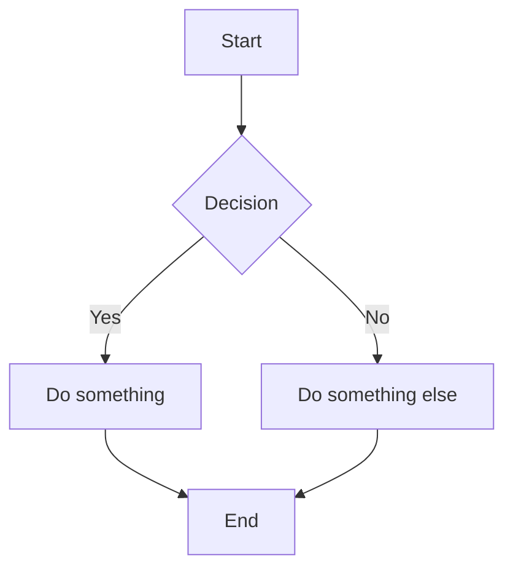

# Sample Document

This is a **test** with _formatting_.

## Emoji Support

Hello :wave: World :smile:

## Code Block

```js
function greet(name) {
  console.log(`Hello, ${name}!`);
}
```

## Table

| Feature | Status |
|---------|--------|
| Images  | ✅     |
| Emoji   | ✅     |
| Mermaid | ✅     |

## Mermaid Diagram


